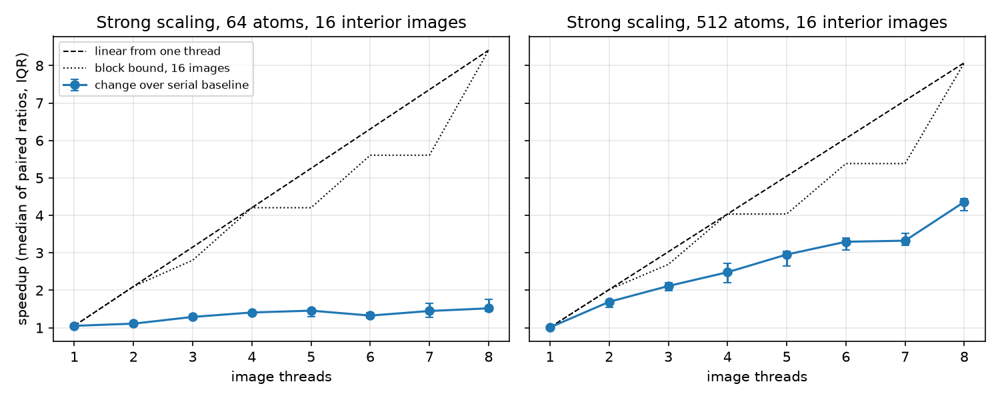
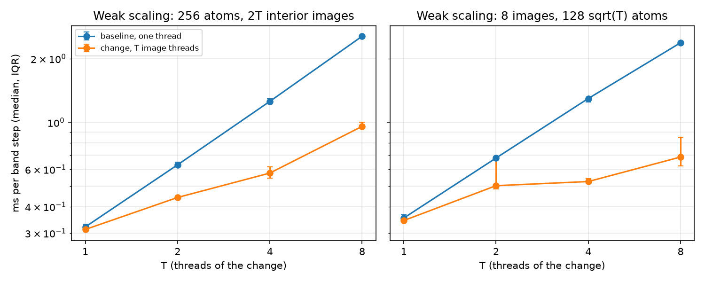
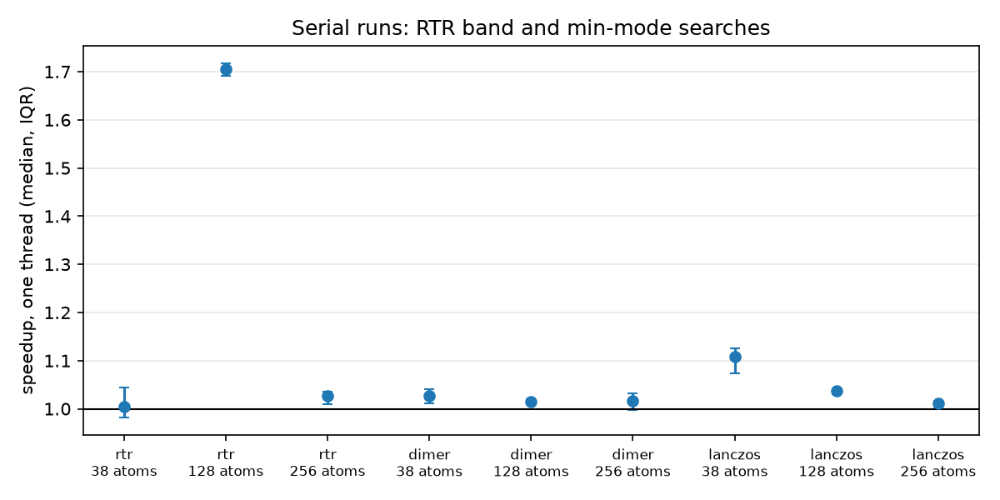

#+TITLE: Step a NEB band
#+OPTIONS: toc:nil num:nil

~BandSession::step~ assembles the tangent, spring and projection forces and advances one host iteration. The fast inertial relaxation engine (~FIRE~) and limited-memory Broyden-Fletcher-Goldfarb-Shanno (~L-BFGS~) methods preserve the endpoints. ~L-BFGS~ computes its direction from the assembled force; summed image energy is not a descent criterion for that force. It also arms eOn's resets: a two-loop step that reaches the per-atom cap or faces away from the force drops the stored pairs and steps along the force, and an empty memory scales that step by 0.01.

Call ~reset~ when the surface changes. The session retains evaluated endpoints and the accepted band while the surface remains valid. A ~Cell~ supplies minimum-image differences for periodic configurations.

The projected force of every image with two or more atoms loses its mean Cartesian part, as in eOn when every atom is free. A host with fixed atoms sets ~BandConfig::remove_translation~ to ~false~, or ~RGSADDLE_BAND_KEEP_TRANSLATION~ in the C band config flags, to keep the mean. An image with one atom keeps its force.

The climbing image is the highest interior image.
That follows Henkelman, Uberuaga and Jónsson (2000).
It also follows the nudged elastic band (NEB) of the Atomic Simulation Environment (ASE).
It climbs also when an endpoint lies higher.
Two minima bound a peak of the path.
So an interior maximum below an endpoint puts the saddle between that image and the endpoint.
The climb moves the image up to it.
An endpoint that is not a minimum can instead sit at the top of a slope the band rises along, with no saddle in between.
An endpoint at or above the highest interior image blocks the climb when its force toward the next image exceeds ~force_tol~.
The band then keeps the spring on every image and reports no climbing image, eOn's rule for a monotonic band.
An endpoint whose gradient the band never evaluated, as at the ends of an AutoNEB window, blocks nothing.
~CiConfig~ decides when it arms.
The default ~CiConfig::after(0.5)~ arms once the band's largest force component falls under 0.5 in the host's force units.
That is eOn's ~ci_after~ in eV/A.
Climbing-image NEB is run on a roughly converged band.
That is the method of Henkelman, Uberuaga and Jonsson, J. Chem. Phys. 113, 9901 (2000), ~doi:10.1063/1.1329672~.
~CiConfig::after_rel(f)~ arms under ~f~ times the first evaluation's force (eOn ~ci_after_rel~).
~CiConfig::always()~ climbs from the first evaluation.
From C ~RGSADDLE_BAND_CI_AFTER~ (ABI minor 17) turns climbing on with ~ci_trigger_force~ and ~ci_trigger_factor~ as given.
Without it climbing needs a positive ~ci_trigger_factor~.

An armed climbing image is refined by its lowest mode, the OCI-NEB of Goswami, Gunde and Jónsson, Front. Chem. 14, 1807063 (2026), doi:10.3389/fchem.2026.1807063. ~BandConfig::min_mode~ holds the ~MinModeRefine~ controls and is on by default; ~None~ keeps the plain CI-NEB. Once the same image has been highest for ~stable_steps~ (1) band step and its largest per-atom force is under ~trigger_factor~ times the largest per-atom force of the first evaluation (infinite by default, so at any force), the first refinement step estimates the lowest mode at that image by Lanczos seeded with the band tangent, keeping up to ~krylov_dim~ (20) Hessian actions. A positive curvature, or a mode with ~|v . tau|~ under ~alignment_tol~ (0.85), hands the image back unmoved and keeps the band optimizer's history. Otherwise that image climbs alone while the other images stay. The climb is an order-1 P-RFO step (Baker, J. Comput. Chem. 7, 385 (1986)) on a dense TS-BFGS model (Bofill, Int. J. Quantum Chem. 94, 324 (2003)). The model is the pair-stretch Hessian of Lindh, Bernhardsson, Karlström and Malmqvist, Chem. Phys. Lett. 241, 423 (1995), over pairs closer than twice the nearest-neighbour distance ~r_nn~, with the pair weight ~exp(-3 (r/r_nn - 1))~ and the diagonal stabilisation of Packwood et al., J. Chem. Phys. 144, 164109 (2016), scaled by the smallest ratio of measured to model curvature over the positive Lanczos directions so it is nowhere stiffer than the surface along them, and then made to match every Lanczos action exactly. With ~remove_translation~ the model and the step live off the rigid translations, and off the rotations too when there is no cell. Each step maximizes along the model eigenvector with the largest overlap with the mode followed a step before, not along the lowest. The trust radius bounds the largest per-atom move by ~max_move~; a ratio of actual to predicted energy change outside ~[1/4, 4]~ halves it, and a ratio inside ~(3/4, 4/3)~ from a step at the radius doubles it. Lanczos runs again, its block imposed and its mode followed, once the followed model curvature is above ~curvature_retained~ (0.3) of the curvature last measured or the followed mode turned under ~min_overlap~ (0.8), at most every ~refresh_interval~ (4) climb steps. The climb hands the image back when the curvature turns positive, measured by Lanczos again before it ends the climb, or after ~max_steps~ (1000), at the aligned point of lowest force it visited. With ~climb_alignment~ (off) it also ends once the followed mode's overlap with the tangent falls under ~alignment_tol~. The trigger re-arms by eqs. 13 to 15 of that paper (~initial_threshold~, ~success_threshold~ and ~backoff_threshold~, shared with ~OcinebSession~), and a refinement that did not lower the force waits also for ~retry_factor~ (0.5) times the force it started from, at least twice ~force_tol~. The re-armed threshold belongs to the image that climbed; when the band's climbing image changes index the threshold returns to ~initial_threshold~. The band then reports ~Converged~ once the climbing image's force is under ~force_tol~; the other images keep their last band positions. Each refinement step reports the curvature in ~BandReport::curvature~ and counts its one-image evaluations in ~surface_rows~. Every one-image evaluation goes through ~BandSurface::eval_image~ with the climbing image's band index; a surface that keys per-image state on that index overrides it. AutoNEB's windows keep the plain climb.

~set_rtr(Some(RtrConfig::default()))~ selects the projected trust-region band method. Its model uses the complete displacement after equal-arc redistribution and the radius cap. The projected method is a heuristic for the nonconservative band force; the report does not certify an energy minimum. The min-mode refinement runs on this band as on the default stepper, and its climb steps take the place of RTR steps while it runs.

~set_force_gate~ chooses the force norm. ~set_highs(true)~ enables rgmin's feasible-step control when the library has the ~highs~ feature. The default ~FIRE~ and ~L-BFGS~ dispatch is unchanged by compiling that feature.

~OcinebSession~ is the same band and the same refinement with the published hand-off controls. Goswami, Gunde, and Jónsson, Front. Chem. 14 (2026), doi:10.3389/fchem.2026.1807063. ~OcinebConfig::refine~ maps them onto ~MinModeRefine~: ~trigger_factor~ (published value 0.31) and ~trigger_force~ to the trigger, ~angle_tol~ (at least ~1/sqrt(2)~, published value 0.85) to the alignment, ~stability_count~ (the index must stay unchanged for more than this many steps, published value 5) to the stability latch, ~max_mmf_steps~ to the climb budget, and ~restore_unhelpful~ as it is. It turns ~climb_alignment~ on and the ~retry_factor~ off, so the climb ends when its mode leaves the tangent cone and re-arms by the published thresholds alone. ~OcinebConfig::minmode~ supplies the mode estimate (kind, finite difference, rotation and Krylov controls); the climb is the band's P-RFO step, so its ~method~, ~force_tol~ and ~max_move~ are not read. ~step~ does one band step, one alignment, or one climb step, and the report names that phase. The alignment step estimates the lowest mode at the climbing image without moving it, and the climb starts only when that curvature is negative and the overlap with the tangent meets ~angle_tol~. The threshold starts at ~initial_threshold~, at least twice the force tolerance; a climb that lowers the force re-arms at ~success_threshold~, ~F_new (1/2 + 2/5 F_new/F_CI)~, and keeps the mode, and any other outcome at ~backoff_threshold~, ~F0 * trigger_factor * (1/2 + 1/2 α)~ with ~α = 0~ after a positive curvature. The band converges when the climbing image meets the force tolerance. The point surface answers the climbing image's evaluations. The solid-state block is refused. This session's band climbs with ~CiConfig::after_rel(0.5)~, which is the relative arming rule and not ~BandConfig::default~.

~BandConfig::quickmin~ selects the quick-min step. The velocity is projected onto the force when that projection is non-negative and replaced by zero otherwise, then the Euler update is ~v <- v + dt F~ and ~dx = dt v~, with ~dt~ the session step (1 by default). The per-atom cap shortens ~dx~ and rescales the velocity by the fraction kept. The projection is one vector over the interior coordinates. FIRE version 2 stays the default. ~BandConfig::quickmin_options~ picks the variant: ~QuickMinOptions::rgmin()~ (default) grows and shrinks ~dt~ with FIRE's factors and projects the whole band at once, ~::eon()~ keeps eOn's fixed ~dt~, and ~::per_atom()~ projects each atom on its own force. ~rgsaddle_band_set_quickmin_variant~ sets the same from C. ~BandConfig::time_step~ is the initial time step, 1 by default; the eOn variant keeps it, and converges on the Al and Pt bands at 0.1 or 0.25 but not at 0.5 or 1. ~rgsaddle_band_set_time_step~ sets it from C.

~SpringKind::OnsagerMachlup { k, l_vecs }~ is the Onsager-Machlup spring of Mandelli and Parrinello (2021), Eq. 13.
It is ~k (R[i+1] + R[i-1] - 2 R[i] + L[i+1] - L[i])~ along the tangent, with the displacements ~l_vecs~ held as the host gave them.
~SpringKind::OnsagerMachlupLive { k }~ rebuilds them before each force assembly from the forces of that evaluation.
Each interior image gets ~L = F / (2 k)~ and each endpoint zero, as eOn's ~buildSpringStrategy~ does on every ~updateForces~.
~spring::onsager_machlup_displacements~ is that rule.
A ~|2 k|~ below 1e-300 gives zero displacements, as eOn's ~safe_recip~ does.
The C spring ordinal 2 is the live kind from ABI minor 33.
AutoNEB, the zoom, the exponential metric and the solid-state block refuse both kinds.

~BandConfig::zoom~ (C ~rgsaddle_band_set_zoom~, application binary interface (ABI) minor 31) is the nudged elastic band (NEB) zoom of eOn's ~NEBZoom.cpp~, Zoom-NEB, and it is off by default. Once the climbing image has kept its index for ~stability~ (5) band steps, the zoom decides. It places the band when the largest per-image force is under ~after~, where 0 takes twice ~force_tol~. Each image force is measured by the session's convergence norm before the maximum is taken, as eOn's ~convergenceForce~ does. The images are then placed at equal arc length on a window around the climbing image, by cubic Hermite segments or linearly. The window takes the contiguous images above the lower endpoint plus ~alpha~ (0.5) of the barrier. An ~alpha~ of 0, or a window of the climbing image alone, takes ~offset~ (1) images on each side. Unlike eOn, the window then always reaches both neighbours of the climbing image, so a one-sided cut cannot turn the climbing image into a fixed endpoint. The window's end images become the fixed endpoints and keep their energies, and the climbing image stays armed; the optimizer history and the min-mode refinement start again. The min-mode refinement does not start before the zoom has decided, since its steps would bypass the zoom; eOn checks the zoom first in each iteration. The band zooms once, and ~zoom_window~ reports the window. ~ZoomConfig::default()~ gives the recommended settings for a band that opts in. With the zoom on, plain climbing image NEB (CI-NEB) on the 51 benchmark pairs of the 38-atom Lennard-Jones cluster (LJ38) converged 20 pairs, where it converged 21 without the zoom. It used more force calls on 10 of the 17 pairs that converged both ways. With the default min-mode refinement on, one LJ38 pair ran to the 250000 call cap. On Müller-Brown at 13 images with FIRE and ~max_move~ 0.05, plain CI-NEB took 30593 force calls with the zoom and 31308 without it. With L-BFGS of memory 100 and climbing from half the first force, the zoom does not help on Müller-Brown: the band took 6503 force calls with it and 3280 without it. The zoom is an opt-in, not a general default. The zoom needs a uniform spring on an atomic band. Equal arc length placement follows the reparameterization of Goswami, Gunde, and Jónsson (2026), section 2.3.6. Cutting the band to the barrier region is the adaptive NEB of Maragakis, Andreev, Brumer, Reichman, and Kaxiras, J. Chem. Phys. 117, 4651 (2002), doi:10.1063/1.1495401.

~AutoNeb~ grows that band. The steps and the window are in =howto/autoneb=. The spring starts uniform and is rescaled inside the search. A weighted or Onsager-Machlup spring supplied by the host is refused until zoom-NEB recomputes it on insertion.

~BandConfig::solid~ adds the generalized solid-state block. The tangent and the spring act on one long vector: the minimum-image atomic displacement through the average of the two cells, then the averaged right strain of the Jacobian-scaled cell difference. The cell part of the force is minus the cell volume times the Cauchy stress plus a hydrostatic pressure times the identity, divided by the Jacobian, with the upper triangle cleared. The Jacobian is the cube root of the mean endpoint volume per atom times the square root of the atom count, times ~weight~, and it stays fixed for the run. Build it with ~SolidState::new(cells)~ and the ~with_pressure~ and ~with_weight~ setters. A surface that supplies the block implements ~BandSurface::eval_cells~ and returns the Cauchy stress, ~(1/V) dE/deps~ for the right strain ~h <- h (I + eps)~ at fixed fractional coordinates. From C, ~rgsaddle_band_create_solid~ builds the band, ~rgsaddle_band_step_solid~ steps it on an ~rgsaddle_solid_surface_fn~ whose request carries the cells in and the stresses out with the energies and gradients, and ~rgsaddle_band_cells~ and ~rgsaddle_band_solid_jacobian~ read it back. ~rgsaddle_band_step~ refuses a solid-state band. An equal-cell path with zero stress and zero pressure matches the atomic band. The doubly nudged term stays on the climbing image.

* Image threads and repeated evaluations
~BandSession::set_image_threads(threads)~ evaluates the band on a pool
of ~threads~ workers that the session keeps.
Each surface call is split into ~min(threads, rows)~ contiguous image
blocks, one ~BandSurface::eval~ per block, and the answers are stored at
their image indices once every block has finished.
The force assembly stays on the calling thread.
One thread is the default and leaves the band as it was; zero threads is
refused.
When the surface's answer for a row depends on that row alone, the band,
its forces and its trajectory are bitwise those of one thread, and the
first failing image is the one reported.
A surface that tells the whole-band evaluation from an interior one by
the row count stays at one thread, as for ~AutoNebTuning::threads~ in
=howto/autoneb=.

The session keeps the buffers of the force assembly (the tangent, spring
and projection of every image and the energy-weighted spring constants)
from one evaluation to the next, so a warm step allocates as often at 13
images as at 5.
A band the session already holds does not go to the surface again: the
accepted band and the band before it answer a repeated request, so a
stepper that rejects a trial and returns to its start, as ODE12r does,
makes no surface call for it.
The projected trust-region method (RTR) keeps the Hessian-vector
products around its current base until the base, the climbing image or
the force gate changes, so the step after a rejection reuses them.
None of this changes a step of the band methods of Goswami, Gunde and
Jonsson, Front. Chem. 14 (2026), doi:10.3389/fchem.2026.1807063, and
Henkelman, Uberuaga and Jonsson, J. Chem. Phys. 113, 9901 (2000),
doi:10.1063/1.1329672.

** Measured scaling
~examples/band_scaling.rs~ times a climbing-image band with FIRE on an
adatom hop of an all-pairs Lennard-Jones cluster (the sites of a
face-centred cubic lattice nearest the origin).
The runs below compare this code with its parent, which has no image
threads, so the parent always runs on one thread.
Each point is six blocks of four serial runs, parent, change, change,
parent, and every run of a point printed the same trajectory hash.
A pair is two neighbouring runs of one block; its ratio is the parent's
time over the change's time.
The tables give the median time per step with its interquartile range
(IQR) and the median of the twelve paired ratios.
The machine had 8 Intel Xeon cores, one thread per core, Linux 6.12 and
rustc 1.99.1.

Strong scaling keeps the band at 16 interior images:

| Atoms | Threads | Parent, ms | Change, ms | Speedup (IQR) | Wins |
|-------+---------+------------+------------+---------------+------|
|    64 |       1 |      0.213 |      0.202 | 1.05 (1.04-1.08) | 11/12 |
|    64 |       8 |      0.206 |      0.136 | 1.52 (1.44-1.75) | 12/12 |
|   512 |       1 |      9.71  |      9.59  | 1.01 (1.00-1.03) |  9/12 |
|   512 |       2 |      9.69  |      5.69  | 1.69 (1.55-1.74) | 12/12 |
|   512 |       4 |      9.40  |      3.79  | 2.48 (2.20-2.71) | 12/12 |
|   512 |       8 |      9.55  |      2.21  | 4.36 (4.12-4.45) | 12/12 |

At one thread the change gains only the buffers: 5% at 64 atoms, where
the surface takes 0.15 ms of a 0.21 ms step, and 1% at 512 atoms, where
it takes 8.5 of 9.1 ms.
Three things hold 512 atoms at 4.36 on 8 threads.
Timing every block over five runs gives medians, which need not add up,
of 2.09 ms per step: 0.67 ms outside the surface call, which stays
serial, and a surface window of 1.34 ms around blocks of 1.16 ms on
average.
The serial part was 0.52 ms on one thread: the FIRE update, the force
assembly and the band copies.
Splitting and joining the blocks adds 0.15 ms to it.
The blocks together spend 9.26 ms of CPU against 8.55 ms on one thread.
Eight serial runs at once did not slow one another (10.9 ms against 10.7
ms per step), so that 8% lies inside the threaded process; its cause is
not isolated.
With 0.67 ms serial, 8 threads cannot pass 5.2 times.
The image count bounds the rest: the longest block holds ~ceil(16/T)~
images, which makes the plateaus at 4 and 5 threads and at 6 and 7 in
the figure.
At 64 atoms one image costs about 9 microseconds, and the split adds
0.05 ms outside the surface and 0.03 ms inside, most of the 0.13 ms that
8 threads could save.

Weak scaling grows the work with the threads.
With 256 atoms and 2T interior images, the change goes from 0.31 ms at
one thread to 0.96 ms at 8, an efficiency of 0.33, and runs 2.61
(2.51-2.71) times as fast as the parent at 8.
The serial assembly and FIRE update grow with the image count here.
With 8 interior images and 128 sqrt(T) atoms, the surface work per
thread of an all-pairs cluster stays fixed and the serial part grows
only with the coordinate count: 0.34 ms to 0.69 ms, an efficiency of
0.50, 3.49 (2.80-3.79) times the parent at 8, 12 of 12 pairs.

RTR runs 100 steps at one thread on 8 interior images.
The memo removes 46% of the surface rows at 128 atoms (13434 to 7258)
and runs 1.71 (1.69-1.72) times as fast.
At 38 and 256 atoms fewer products repeat after a rejection: 9% of the
rows go (16546 to 15018) and 5% (75642 to 71770).
At 256 atoms that is 1.03 (1.01-1.04), 12 of 12 pairs.
At 38 atoms a row costs about 5 microseconds, the saved rows would be
about 9% of the time, and the ratio is 1.005 (0.98-1.04), 7 of 12: at
that size the copies and comparisons of the memo cost about as much as
the rows they save.

** Reproduce
Build the example on both commits.
On a parent without ~set_image_threads~, replace that call with
~assert_eq!(threads, 1);~.
Then, from the repository root:

#+begin_src sh
cargo build --release --example band_scaling
python docs/source/figures/band-scaling/run.py \
    <parent-binary> target/release/examples/band_scaling target/scaling
uv run --no-project --with matplotlib --with numpy \
    python docs/source/figures/band-scaling/plot.py target/scaling
#+end_src
