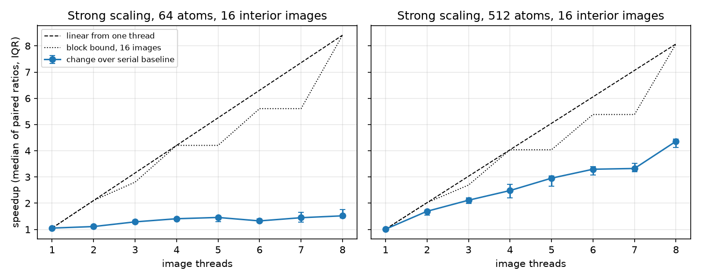
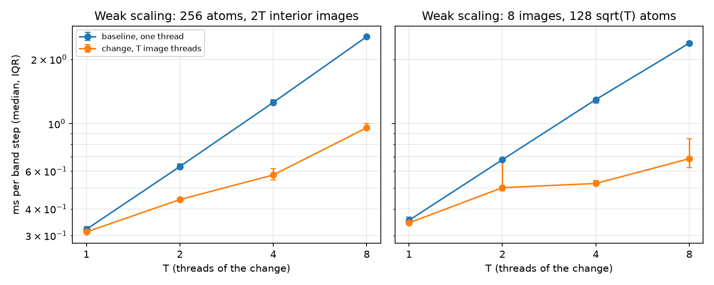
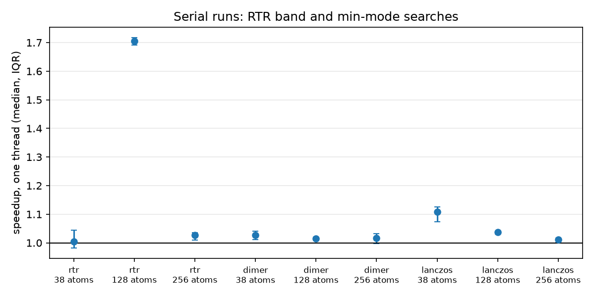

#+TITLE: Step a NEB band
#+OPTIONS: toc:nil num:nil

#+begin_export rst
:cite:`goswamiEnhancedClimbingImage2026,goswamiReproducibleOrchestration2026,goswamiIdpp2026,henkelmanClimbingImageNudged2000,henkelmanImprovedTangentEstimate2000,smidstrupImprovedInitialGuess2014,schmerwitzImprovedInitializationOptimal2024,packwoodUniversalPreconditioner2016,makriPreconditioningScheme2019,eSimplifiedImprovedString2007,petersGrowingStringMethod2004,zhangFreeEndAdaptive2016,zhuInterfacialPlasticity2007`
#+end_export

~BandSession::step~ assembles the tangent, spring and projection forces and advances one host iteration. The fast inertial relaxation engine (~FIRE~) and limited-memory Broyden-Fletcher-Goldfarb-Shanno (~L-BFGS~) methods preserve the endpoints. ~L-BFGS~ computes its direction from the assembled force; summed image energy is not a descent criterion for that force. It also arms eOn's resets: a two-loop step that reaches the per-atom cap or faces away from the force drops the stored pairs and steps along the force, and an empty memory scales that step by 0.01.

Call ~reset~ when the surface changes. The session retains evaluated endpoints and the accepted band while the surface remains valid. A ~Cell~ (~mic::wrap_difference~) supplies minimum-image differences for periodic configurations.

* Runnable example: NEB, climbing image, OCI-NEB, and IDPP

Orchestration and best practices for nudged elastic band paths follow Goswami, arXiv:2603.14737 (2026), doi:10.48550/arXiv.2603.14737, and the off-path climbing image refinement (OCI-NEB) follows Goswami, Gunde, and Jónsson, Front. Chem. 14, 1807063 (2026), doi:10.3389/fchem.2026.1807063. Image-dependent pair potential (IDPP) path initialization follows Goswami, MethodsX, 103899 (2026), doi:10.1016/j.mex.2026.103899, Smidstrup, Pedersen, Stokbro, and Jónsson, J. Chem. Phys. 140, 214106 (2014), doi:10.1063/1.4878664, and the sequential S-IDPP variant of Schmerwitz, Ásgeirsson, and Jónsson, J. Chem. Theory Comput. 20, 155 (2024), doi:10.1021/acs.jctc.3c01111.

#+begin_src rust
use ndarray::{Array1, Array2, ArrayView1, ArrayView2, array};
use rgsaddle::{
    BandConfig, BandSession, BandStatus, BandSurface, CiConfig, IdppConfig, OcinebConfig,
    OcinebPhase, OcinebSession, OcinebStatus, PointSurface, SaddleError, SidppConfig, idpp_path,
    linear_path, sidpp_path,
};

struct DoubleWell;

impl BandSurface for DoubleWell {
    fn eval(
        &self,
        positions: ArrayView2<f64>,
        energies: &mut Array1<f64>,
        gradients: &mut Array2<f64>,
    ) -> Result<(), SaddleError> {
        for (i, row) in positions.rows().into_iter().enumerate() {
            let (x, y, z) = (row[0], row[1], row[2]);
            energies[i] = (x * x - 1.0).powi(2) + 2.0 * y * y + 2.0 * z * z;
            gradients[(i, 0)] = 4.0 * x * (x * x - 1.0);
            gradients[(i, 1)] = 4.0 * y;
            gradients[(i, 2)] = 4.0 * z;
        }
        Ok(())
    }
}

impl PointSurface for DoubleWell {
    fn eval(&self, x: ArrayView1<f64>) -> Result<(f64, Array1<f64>), SaddleError> {
        let (px, py, pz) = (x[0], x[1], x[2]);
        let e = (px * px - 1.0).powi(2) + 2.0 * py * py + 2.0 * z_part(pz);
        Ok((e, array![4.0 * px * (px * px - 1.0), 4.0 * py, 4.0 * pz]))
    }
}

fn z_part(pz: f64) -> f64 {
    pz * pz
}

fn main() -> Result<(), SaddleError> {
    let reactant = array![-1.0, 0.0, 0.0, -1.0, 1.0, 0.0];
    let product = array![1.0, 0.0, 0.0, 1.0, 1.0, 0.0];
    let _line: Array2<f64> = linear_path(reactant.view(), product.view(), 5, None)?;
    let _sidpp: Array2<f64> =
        sidpp_path(reactant.view(), product.view(), 5, None, &SidppConfig::default())?;
    let start: Array2<f64> =
        idpp_path(reactant.view(), product.view(), 5, None, &IdppConfig::default())?;

    let single_ends = array![[-1.0, 0.2, 0.0], [0.0, 0.3, 0.0], [1.0, 0.2, 0.0]];
    let config = BandConfig::default()
        .with_climbing(CiConfig::after(0.5))
        .with_force_tol(1e-3);
    let mut band = BandSession::new(config, single_ends.clone())?;
    let report = band.run(&DoubleWell, 200)?;
    assert_eq!(report.status, BandStatus::Converged);

    let mut ocineb = OcinebSession::new(OcinebConfig::default(), single_ends)?;
    let oci_report = ocineb.step(&DoubleWell)?;
    assert!(matches!(
        oci_report.phase,
        OcinebPhase::Band | OcinebPhase::Align | OcinebPhase::MinMode
    ));
    let _ = (start, OcinebStatus::Running);
    Ok(())
}
#+end_src

The projected force of every image with two or more atoms loses its mean Cartesian part, as in eOn when every atom is free. ~BandConfig::remove_translation~ set to ~false~, or ~RGSADDLE_BAND_KEEP_TRANSLATION~ in the C band config flags, keeps the mean. A band with any fixed atom keeps it without either. An image with one atom keeps its force.

The climbing image is the highest interior image.
That follows Henkelman, Uberuaga and Jónsson (2000).
It also follows the nudged elastic band (NEB) of the Atomic Simulation Environment (ASE).
It climbs also when an endpoint lies higher.
Two minima bound a peak of the path.
So an interior maximum below an endpoint puts the saddle between that image and the endpoint.
The climb moves the image up to it.
An endpoint that is not a minimum can instead sit at the top of a slope the band rises along, with no saddle in between.
An endpoint at or above the highest interior image blocks the climb when its force toward the next image exceeds ~force_tol~.
The band then keeps the spring on every image and reports no climbing image, eOn's rule for a monotonic band.
An endpoint whose gradient the band never evaluated, as at the ends of an AutoNEB window, blocks nothing.
~CiConfig~ decides when it arms.
The default ~CiConfig::after(0.5)~ arms once the band's largest force component falls under 0.5 in the host's force units.
That is eOn's ~ci_after~ in eV/A.
Climbing-image NEB is run on a roughly converged band.
That is the method of Henkelman, Uberuaga and Jonsson, J. Chem. Phys. 113, 9901 (2000), ~doi:10.1063/1.1329672~.
~CiConfig::after_rel(f)~ arms under ~f~ times the first evaluation's force (eOn ~ci_after_rel~).
~CiConfig::always()~ climbs from the first evaluation.
From C ~RGSADDLE_BAND_CI_AFTER~ (ABI minor 17) turns climbing on with ~ci_trigger_force~ and ~ci_trigger_factor~ as given.
Without it climbing needs a positive ~ci_trigger_factor~.

An armed climbing image is refined by its lowest mode, the OCI-NEB of Goswami, Gunde and Jónsson, Front. Chem. 14, 1807063 (2026), doi:10.3389/fchem.2026.1807063. ~BandConfig::min_mode~ holds the ~MinModeRefine~ controls and is on by default; ~None~ keeps the plain CI-NEB. Once the same image has been highest for ~stable_steps~ (1) band step and its largest per-atom force is under ~trigger_factor~ times the largest per-atom force of the first evaluation (infinite by default, so at any force), the first refinement step estimates the lowest mode at that image by Lanczos seeded with the band tangent, keeping up to ~krylov_dim~ (20) Hessian actions. A positive curvature, or a mode with ~|v . tau|~ under ~alignment_tol~ (0.85), hands the image back unmoved and keeps the band optimizer's history. Otherwise that image climbs alone while the other images stay. The climb is an order-1 P-RFO step (Baker, J. Comput. Chem. 7, 385 (1986)) on a dense TS-BFGS model (Bofill, Int. J. Quantum Chem. 94, 324 (2003)). The model is the pair-stretch Hessian of Lindh, Bernhardsson, Karlström and Malmqvist, Chem. Phys. Lett. 241, 423 (1995), over pairs closer than twice the nearest-neighbour distance ~r_nn~, counted under a cell through every periodic image in that range and not only the minimum image, with the pair weight ~exp(-3 (r/r_nn - 1))~ and the diagonal stabilisation of Packwood et al., J. Chem. Phys. 144, 164109 (2016), scaled by the smallest ratio of measured to model curvature over the positive Lanczos directions so it is nowhere stiffer than the surface along them, and then made to match every Lanczos action exactly. With ~remove_translation~ the model and the step live off the rigid translations, and off the rotations too when there is no cell. Each step maximizes along the model eigenvector with the largest overlap with the mode followed a step before, not along the lowest. The trust radius bounds the largest per-atom move by ~max_move~; a ratio of actual to predicted energy change outside ~[1/4, 4]~ halves it, and a ratio inside ~(3/4, 4/3)~ from a step at the radius doubles it. Lanczos runs again, its block imposed and its mode followed, once the followed model curvature is above ~curvature_retained~ (0.3) of the curvature last measured or the followed mode turned under ~min_overlap~ (0.8), at most every ~refresh_interval~ (4) climb steps. The climb hands the image back when the curvature turns positive, measured by Lanczos again before it ends the climb, or after ~max_steps~ (1000), at the aligned point of lowest force it visited. With ~climb_alignment~ (off) it also ends once the followed mode's overlap with the tangent falls under ~alignment_tol~. The trigger re-arms by eqs. 13 to 15 of that paper (~initial_threshold~, ~success_threshold~ and ~backoff_threshold~, shared with ~OcinebSession~), and a refinement that did not lower the force waits also for ~retry_factor~ (0.5) times the force it started from, at least twice ~force_tol~. The re-armed threshold belongs to the image that climbed; when the band's climbing image changes index the threshold returns to ~initial_threshold~. The band then reports ~Converged~ once the climbing image's force is under ~force_tol~; the other images keep their last band positions. Each refinement step reports the curvature in ~BandReport::curvature~ and counts its one-image evaluations in ~surface_rows~. Every one-image evaluation goes through ~BandSurface::eval_image~ with the climbing image's band index; a surface that keys per-image state on that index overrides it. AutoNEB's windows keep the plain climb.

~set_rtr(Some(RtrConfig::default()))~ selects the projected trust-region band method. Its model uses the complete displacement after equal-arc redistribution and the radius cap. The projected method is a heuristic for the nonconservative band force; the report does not certify an energy minimum. The min-mode refinement runs on this band as on the default stepper, and its climb steps take the place of RTR steps while it runs.

~RtrConfig::reparametrization~ selects how each RTR trial is spread at equal arc length. ~Reparametrization::Linear~, the default, places the interior images on the polyline. ~Reparametrization::NotAKnot~ fits the not-a-knot cubic spline through the images in their polyline arc length, the interpolation of the simplified string method (E, Ren, and Vanden-Eijnden, J. Chem. Phys. 126, 164103 (2007), doi:10.1063/1.2720838), and places the images at equal steps of the spline's own arc length, measured by Gauss-Legendre quadrature. The paper evaluates the spline at uniform polyline arc instead; both choices lie on the same curve, and measuring along the spline spaces an uneven band evenly in one pass. Three distinct images give the interpolating parabola and two the chord. Images whose arc lengths agree to 1e-12 of the total share one knot, so coincident images do not make the fit singular. In a periodic cell the chain is unwrapped by minimum-image chords before the fit and every placed image moves by the minimum image of its displacement. Endpoints and the climbing image keep their bits. The spline reproduces a cubic in arc length, keeps a straight band exactly on its line, and on images sampled from a smooth curve its off-curve error falls with the fourth power of the spacing where the polyline's falls with the second (~tests/reparam.rs~). On the RTR double-well band of ~tests/rtr_capi.rs~ (7 images) both placements reach the same climbing image; the spline took 3827 surface rows in 21 steps and the polyline 3367 rows in 16, so the polyline stays the default. ~rgsaddle::reparametrize~ applies either scheme to a band without a surface call, ~Mesh::RemeshSpline~ does it on a stencil chain, and from C ~rgsaddle_reparametrize~ and band flag ~RGSADDLE_BAND_SPLINE_REPARAM~ (ABI minor 38) do the same. The rgsaddle band has no geodesic coordinates of its own: the chords are Cartesian, minimum images in a cell, and a host that interpolates in other coordinates passes those as the rows.

~set_force_gate~ chooses the force norm. ~set_highs(true)~ enables rgmin's feasible-step control when the library has the ~highs~ feature. The default ~FIRE~ and ~L-BFGS~ dispatch is unchanged by compiling that feature.

~OcinebSession~ is the same band and the same refinement with the published hand-off controls. Goswami, Gunde, and Jónsson, Front. Chem. 14 (2026), doi:10.3389/fchem.2026.1807063. ~OcinebConfig::refine~ maps them onto ~MinModeRefine~: ~trigger_factor~ (published value 0.31) and ~trigger_force~ to the trigger, ~angle_tol~ (at least ~1/sqrt(2)~, published value 0.85) to the alignment, ~stability_count~ (the index must stay unchanged for more than this many steps, published value 5) to the stability latch, ~max_mmf_steps~ to the climb budget, and ~restore_unhelpful~ as it is. It turns ~climb_alignment~ on and the ~retry_factor~ off, so the climb ends when its mode leaves the tangent cone and re-arms by the published thresholds alone. ~OcinebConfig::minmode~ supplies the mode estimate (kind, finite difference, rotation and Krylov controls); the climb is the band's P-RFO step, so its ~method~, ~force_tol~ and ~max_move~ are not read. ~step~ does one band step, one alignment, or one climb step, and the report names that phase. The alignment step estimates the lowest mode at the climbing image without moving it, and the climb starts only when that curvature is negative and the overlap with the tangent meets ~angle_tol~. The threshold starts at ~initial_threshold~, at least twice the force tolerance; a climb that lowers the force re-arms at ~success_threshold~, ~F_new (1/2 + 2/5 F_new/F_CI)~, and keeps the mode, and any other outcome at ~backoff_threshold~, ~F0 * trigger_factor * (1/2 + 1/2 α)~ with ~α = 0~ after a positive curvature. The band converges when the climbing image meets the force tolerance. The band's ~saddle_check~ then certifies the climbing image as on a band session, and ~OcinebReport::saddle_index~, ~OcinebSession::saddle_index~ and ~set_saddle_check~ carry it. The point surface answers the climbing image's evaluations. The solid-state block is refused. This session's band climbs with ~CiConfig::after_rel(0.5)~, which is the relative arming rule and not ~BandConfig::default~.

~BandConfig::quickmin~ selects the quick-min step. The velocity is projected onto the force when that projection is non-negative and replaced by zero otherwise, then the Euler update is ~v <- v + dt F~ and ~dx = dt v~, with ~dt~ the session step (1 by default). The per-atom cap shortens ~dx~ and rescales the velocity by the fraction kept. The projection is one vector over the interior coordinates. FIRE version 2 stays the default. ~BandConfig::quickmin_options~ picks the variant: ~QuickMinOptions::rgmin()~ (default) grows and shrinks ~dt~ with FIRE's factors and projects the whole band at once, ~::eon()~ keeps eOn's fixed ~dt~, and ~::per_atom()~ projects each atom on its own force. ~rgsaddle_band_set_quickmin_variant~ sets the same from C. ~BandConfig::time_step~ is the initial time step, 1 by default; the eOn variant keeps it, and converges on the Al and Pt bands at 0.1 or 0.25 but not at 0.5 or 1. ~rgsaddle_band_set_time_step~ sets it from C.

~SpringKind::OnsagerMachlup { k, l_vecs }~ is the Onsager-Machlup spring of Mandelli and Parrinello (2021), Eq. 13.
It is ~k (R[i+1] + R[i-1] - 2 R[i] + L[i+1] - L[i])~ along the tangent, with the displacements ~l_vecs~ held as the host gave them.
~SpringKind::OnsagerMachlupLive { k }~ rebuilds them before each force assembly from the forces of that evaluation.
Each interior image gets ~L = F / (2 k)~ and each endpoint zero, as eOn's ~buildSpringStrategy~ does on every ~updateForces~.
~spring::onsager_machlup_displacements~ is that rule.
A ~|2 k|~ below 1e-300 gives zero displacements, as eOn's ~safe_recip~ does.
The C spring ordinal 2 is the live kind from ABI minor 33.
AutoNEB, the zoom, the exponential metric and the solid-state block refuse both kinds.

~BandConfig::zoom~ (C ~rgsaddle_band_set_zoom~, application binary interface (ABI) minor 31) is the nudged elastic band (NEB) zoom of eOn's ~NEBZoom.cpp~, Zoom-NEB, and it is off by default. Once the climbing image has kept its index for ~stability~ (5) band steps, the zoom decides. It places the band when the largest per-image force is under ~after~, where 0 takes twice ~force_tol~. Each image force is measured by the session's convergence norm before the maximum is taken, as eOn's ~convergenceForce~ does. The images are then placed at equal arc length on a window around the climbing image, by cubic Hermite segments or linearly. The window takes the contiguous images above the lower endpoint plus ~alpha~ (0.5) of the barrier. An ~alpha~ of 0, or a window of the climbing image alone, takes ~offset~ (1) images on each side. Unlike eOn, the window then always reaches both neighbours of the climbing image, so a one-sided cut cannot turn the climbing image into a fixed endpoint. The window's end images become the fixed endpoints and keep their energies, and the climbing image stays armed; the optimizer history and the min-mode refinement start again. The min-mode refinement does not start before the zoom has decided, since its steps would bypass the zoom; eOn checks the zoom first in each iteration. The band zooms once, and ~zoom_window~ reports the window. ~ZoomConfig::default()~ gives the recommended settings for a band that opts in. With the zoom on, plain climbing image NEB (CI-NEB) on the 51 benchmark pairs of the 38-atom Lennard-Jones cluster (LJ38) converged 20 pairs, where it converged 21 without the zoom. It used more force calls on 10 of the 17 pairs that converged both ways. With the default min-mode refinement on, one LJ38 pair ran to the 250000 call cap. On Müller-Brown at 13 images with FIRE and ~max_move~ 0.05, plain CI-NEB took 30593 force calls with the zoom and 31308 without it. With L-BFGS of memory 100 and climbing from half the first force, the zoom does not help on Müller-Brown: the band took 6503 force calls with it and 3280 without it. The zoom is an opt-in, not a general default. The zoom needs a uniform spring on an atomic band. Equal arc length placement follows the reparameterization of Goswami, Gunde, and Jónsson (2026), section 2.3.6. Cutting the band to the barrier region is the adaptive NEB of Maragakis, Andreev, Brumer, Reichman, and Kaxiras, J. Chem. Phys. 117, 4651 (2002), doi:10.1063/1.1495401.

~AutoNeb~ grows that band. The steps and the window are in =howto/autoneb=. The spring starts uniform and is rescaled inside the search. A weighted or Onsager-Machlup spring supplied by the host is refused until zoom-NEB recomputes it on insertion.

~BandConfig::solid~ adds the generalized solid-state block. The tangent and the spring act on one long vector: the minimum-image atomic displacement through the average of the two cells, then the averaged right strain of the Jacobian-scaled cell difference. The cell part of the force is minus the cell volume times the Cauchy stress plus a hydrostatic pressure times the identity, divided by the Jacobian, with the upper triangle cleared. The Jacobian is the cube root of the mean endpoint volume per atom times the square root of the atom count, times ~weight~, and it stays fixed for the run. Build it with ~SolidState::new(cells)~ and the ~with_pressure~ and ~with_weight~ setters. A surface that supplies the block implements ~BandSurface::eval_cells~ and returns the Cauchy stress, ~(1/V) dE/deps~ for the right strain ~h <- h (I + eps)~ at fixed fractional coordinates. From C, ~rgsaddle_band_create_solid~ builds the band, ~rgsaddle_band_step_solid~ steps it on an ~rgsaddle_solid_surface_fn~ whose request carries the cells in and the stresses out with the energies and gradients, and ~rgsaddle_band_cells~ and ~rgsaddle_band_solid_jacobian~ read it back. ~rgsaddle_band_step~ refuses a solid-state band. An equal-cell path with zero stress and zero pressure matches the atomic band. The doubly nudged term stays on the climbing image.

* Simplified string method

~BandConfig::with_string(StringConfig::default())~ (and ~BandSession::set_string~ between steps) selects the simplified string method of E, Ren, and Vanden-Eijnden, J. Chem. Phys. 126, 164103 (2007), doi:10.1063/1.2720838 @@rst::cite:`eSimplifiedImprovedString2007`@@, in place of the nudged elastic band.
Each step evolves the interior images under the full potential force \(-\nabla V(x_i)\), with no spring and no tangent projection, through the session's ~rgmin::Solver~ stepper (~FIRE~, ~L-BFGS~, ~QuickMin~, ~Bb~, or ~ODE12r~), and then places the interior images at equal arc length with ~reparametrize~.
~StringConfig::spline()~ (~Reparametrization::NotAKnot~, the default) fits the not-a-knot cubic spline through the images in their polyline arc length and spaces them at equal arc length of the spline; ~StringConfig::linear()~ (~Reparametrization::Linear~) spaces them on the polyline.
With ~BandConfig::climbing~ set, an armed climbing image reflects the potential force along the path tangent and acts as an interior anchor during reparametrization so each side of it is spaced at equal arc length on its own, while ~with_climbing(None)~ runs the plain equal-arc string across the whole path.
The session keeps both endpoint images fixed. This differs from the endpoint evolution in the paper and matches the fixed-endpoint contract of the other band methods in this crate.
L-BFGS keeps reparametrized secant pairs explicitly. The non-L-BFGS steppers are rebuilt after every accepted string step to install the transverse-curvature time-step bound, so FIRE, QuickMin, Bb, and ODE12r do not carry momentum or other integrator state between string iterations.
Fixed-atom masks, periodic ~Cell~ minimum-image wrapping, ~ExpBandPrecon~, ~MinModeRefine~, ~SaddleIndexCheck~, and ~set_image_threads~ apply as on an atomic NEB band; the solid-state cell block, ~AutoNeb~, and ~BandRtr~ are refused.
From C (ABI minor 44), ~RGSADDLE_BAND_STRING~ in ~rgsaddle_band_config_t.flags~ (paired with ~RGSADDLE_BAND_SPLINE_REPARAM~ for the spline, or clear for the polyline) and ~rgsaddle_band_set_string~ select the method, ~rgsaddle::Band::set_string~ wraps it in C++, and Python exposes ~rgsaddle.Band(..., string=True)~, ~_core.project_band(..., projection="string")~, and ~rgsaddle.ase.SimplifiedString~.

On the Müller-Brown surface (=tests/simplified_string.rs=, 25 images between minima A and B at force tolerance 0.001), self-measured regression pins from this implementation put the first under-tolerance spline step at 147 iterations and 6787 force rows; stable convergence is confirmed at 148 iterations and 6833 rows. Its maximum Euclidean deviation from the separately integrated steepest-descent path is 0.0111, while the polyline string regression gives 0.0144. A separately configured 25-image CI-NEB regression gives 0.0305 in 2190 force rows; because its climbing and optimizer settings differ, these figures are not a method-ranking comparison. These are regression measurements, not values reported by E, Ren, and Vanden-Eijnden.
With climbing enabled, the climbing string locates the primary saddle at \((-0.822001, 0.624313)\), energy \(-40.664844\), matching the analytic saddle and CI-NEB within 0.001, and on the C-to-B segment (13 images) locates the secondary saddle at \((0.212485, 0.292987)\), energy \(-72.248940\), both certified at Hessian index 1.
On the 107-atom Morse Cu fcc vacancy hop of Makri, Ortner, and Kermode @@rst::cite:`makriPreconditioningScheme2019`@@ (=tests/makri_vacancy.rs=, 5 images, ~L-BFGS~ memory 20, tolerance 0.001 eV/Å), self-measured regressions put the spline simplified string at 37 steps (75.67 evaluations per interior image) and a barrier of 1.84369893 eV, the climbing spline string at 35 steps (71.67 evaluations per image) and 1.84369903 eV, and the linear string at 149 steps and 1.84370066 eV, against 1.84369917 eV for NEB (18 steps, 19.67 evaluations per image). The cited paper reports no simplified-string value for this Cu case.

~GrowingStringSession~ (~GrowingStringConfig::default()~, C ~rgsaddle_growing_string_create~ at ABI minor 44, C++ ~rgsaddle::GrowingString~, Python ~rgsaddle.GrowingString~ and ~rgsaddle.ase.GrowingString~) implements the growing string method of Peters, Heyden, Bell, and Chakraborty, J. Chem. Phys. 120, 7877 (2004), doi:10.1063/1.1691018 @@rst::cite:`petersGrowingStringMethod2004`@@.
Starting from only the reactant and product endpoints, it grows two separate string fragments inward with frontier tangent constraints (\(\Delta w_{\mathrm{frontier}} \cdot \hat{t}_{\mathrm{frontier}} = 0\)), separate per-fragment ~rgmin::Solver~ relaxation, and a configurable node-add criterion (~frontier_tol~, ~min_steps_per_node~, ~max_steps_per_node~, ~join_tol~).
When the fragments meet, ~GrowingStringSession~ detects the join and hands off to ~StringSession~ while preserving every image's ~ImageId~ and batched surface evaluations.
On the 2D curved parabolic channel with a central obstacle (=tests/growing_string.rs=, 11 images), ~GrowingStringSession~ avoids the high-energy linear midpoint and converges in 68 steps (873 force evaluations) to the saddle \((0.0, 1.008371)\), energy \(1.010629\), matching CI-NEB (72 steps, 744 force evaluations). On Müller-Brown (15 images, ~L-BFGS~), it locates the primary saddle \((-0.822001, 0.624313)\) in 86 steps (1832 force evaluations), matching CI-NEB at \((-0.822002, 0.624313)\) in 59 steps (785 force evaluations).

* Free-end adaptive NEB

~BandConfig::with_free_end(FreeEndConfig::default())~ (~BandSession::set_free_end~, ~FeaNebSession~, C ~rgsaddle_band_set_free_end~ at ABI minor 45, C++ ~Band::set_free_end~, Python ~Band.set_free_end~) implements the free-end adaptive nudged elastic band (FEA-NEB) of Jiayong Zhang, Hongwu Zhang, Hongfei Ye, and Yonggang Zheng, J. Chem. Phys. 145, 094104 (2016), doi:10.1063/1.4962019 @@rst::cite:`zhangFreeEndAdaptive2016`@@, building on the free-end level-set endpoint formulation of Ting Zhu, Ju Li, Amit Samanta, Hyoung Gyu Kim, and Subra Suresh, Proc. Natl. Acad. Sci. U.S.A. 104, 3031 (2007), doi:10.1073/pnas.0611097104 @@rst::cite:`zhuInterfacialPlasticity2007`@@. Climbing on the final cut level reuses the climbing image, and with minimum-mode refinement left on, the off-path climb of Goswami, Gunde, and Jónsson, Front. Chem. 14 (2026), doi:10.3389/fchem.2026.1807063 @@rst::cite:`goswamiEnhancedClimbingImage2026`@@. A nonzero endpoint gradient is required and the endpoint residual is reported.
Fixed endpoints remain the default (~BandConfig::free_end~ is ~None~). The free-end band is not combined with ~BandConfig::dynamic~: ~BandSession::new~, ~BandSession::set_free_end~, and ~BandSession::set_dynamic~ return ~SaddleError::Invalid~ when both would be on.
A free-end step asks the surface for the fixed terminal image once, and again only after a cut moves it to the window edge. The evaluation a step ends on is kept, so the next step starts from it instead of evaluating the band again, unless the host moved a row with ~BandSession::set_positions~ or called ~BandSession::reset~. ~FreeEndReport::surface_rows~ counts the rows the surface saw.
When enabled, one terminal image (~FreeEndSide::Last~ by default, or ~FreeEndSide::First~) takes Zhang et al. Eq. (7), the potential force perpendicular to the one-neighbour tangent, \(F^p_{\mathrm{end},\perp}=-\nabla E+(\nabla E\cdot\hat{\tau}_{\mathrm{end}})\hat{\tau}_{\mathrm{end}}\). That force does not include a spring. Net translation is removed, when the band drops it, before the force is projected onto the tangent hyperplane of \(E(x_{\mathrm{end}}) = E_{\mathrm{target}}\). Each accepted endpoint geometry is then retracted onto that level set with ~rgmin::Solver~ and ~rgmin::LevelSetConstraint~.
The terminal image requires a finite, nonzero potential gradient and reports the signed residual \(E(x_{\mathrm{end}}) - E_{\mathrm{target}}\) in ~FreeEndReport::target_energy_residual~ and ~BandSession::target_energy_residual~. ~BandSession::evaluation~ returns the energies, gradients, and projected interior forces at the positions that step reported.
With ~max_cuts > 0~, once the detected peak image holds its index for ~stability~ steps and the band force falls below the level threshold while rising above its neighbours by more than ~energy_tol~, images outside the local window of ~window_offset~ images on each side of the peak are dropped. The band is remeshed at equal arc length along the window and, when the free terminal image lies outside that window, along the leg from the window to the free end, so the free end stays an endpoint and the spacing stays even. A window that would put the peak on an end, or that would remove no image, is not counted. A refused endpoint curvature pair is a stalled step and does not move the endpoint. ~BandSession::step_free_end~ and ~FeaNebSession::step~ run a latched minimum-mode refinement when climbing is on, the same way ~BandSession::step~ does.
On a narrow barrier on a long tilted 2D path (=tests/free_end_neb.rs=), 7-image FEA-NEB with two cut-and-remesh refinements converges in 95 steps (1326 force evaluations, target-energy residual \(5.10 \times 10^{-8}\)) to the saddle \((0.820770, 0.205179)\) and barrier \(1.553678\), matching 21-image fixed-end CI-NEB (\((0.820788, 0.205196)\), barrier \(1.553678\), 1982 force evaluations) with three times fewer images.

* Fixed atoms

~BandConfig::with_fixed_atoms~ takes one ~bool~ per atom, shared by every image; ~true~ fixes the atom. From C, ~rgsaddle_band_set_fixed_atoms~ (ABI minor 39) takes the same mask as one byte per atom, 0 or 1, on a band made by ~rgsaddle_band_create~, and ~BandSession::set_fixed_atoms~ is the Rust call between steps. The mask is for a slab with a frozen bottom layer, ASE's ~FixAtoms~, eOn's fixed atoms or a LAMMPS ~fix setforce 0~ group.

A fixed atom never moves. The band reads its gradient as zero, so it carries no force in the FIRE, L-BFGS, quick-min, ODE12r or trust-region (RTR) step, in ~BandReport::max_force~, or in ~BandEvaluation~. Tangents, springs and the climbing direction are formed on the free coordinates, and the min-mode refinement estimates the mode and climbs on the free coordinates only. The session then copies the first image's fixed coordinates into every interior image after each move, so the frozen positions stay the same to the bit. With any atom fixed, the mean force stays.

The endpoints must place every fixed atom at the same point, up to the minimum image and 1e-10 per component. A mismatch is refused with ~SaddleError::Invalid~ naming the atom, as is a mask that fixes every atom, a mask on a solid-state band, and a mask on ~SolidNeb::joint~. A mask of the wrong length is ~SaddleError::Shape~. Interior images take the first image's fixed coordinates when the session is built and on each ~set_positions~. A mask with no ~true~ entry leaves the band the same to the bit as one without a mask.

Before minor 39, a host zeroed the frozen forces itself and kept the mean with ~RGSADDLE_BAND_KEEP_TRANSLATION~. That still works for the plain metric. It does not work with ~rgsaddle_band_set_exp_precon~: the exponential matrix couples every atom to its neighbours, so ~P^-1 g~ moves a frozen atom whose own gradient is zero. With the mask the matrix is built on the free atoms alone, so ~P^-1~ acts on the free block and the frozen atoms stay.

* Preconditioning with fixed atoms

~BandConfig::exp_precon~ (C ~rgsaddle_band_set_exp_precon~, ABI minor 22) is the exponential metric of Packwood et al., J. Chem. Phys. 144, 164109 (2016), applied inside the band projection as Makri, Ortner and Kermode, J. Chem. Phys. 150, 094109 (2019), apply it. On a band with fixed atoms each image's matrix has one block row per free atom. Fixed atoms still count as neighbours: they enter the nearest-neighbour distance ~r_nn~, and the pairs within ~r_cut_factor * r_nn~ are chosen over all atoms. A free atom's bond to a fixed atom adds its weight to that free atom's diagonal block only, and a bond between two fixed atoms drops out. That is the free block ASE's ~Exp~ preconditioner keeps under ~FixAtoms~. The metric force is formed on the free block and scattered back, and the frozen rows stay zero.

On the Morse fcc(100) slab of =examples/fixed_slab_precon.rs=, with its bottom layer of nine atoms fixed and an adatom hopping between neighbouring hollow sites, every stepper converges with the frozen layer unchanged to the bit. ODE12r-Exp and FIRE-Exp reach the same stationary point as plain FIRE and L-BFGS, energy within 1e-6, at ~force_tol~ 1e-4; that point is a saddle of index 3, as the next section shows. =benchmarks/fixed_slab_precon.csv= has the force calls and wall time of plain CI-NEB at ~force_tol~ 1e-3, seven images, with the min-mode refinement and the saddle check off; =cargo run --release --example fixed_slab_precon -- benchmarks/fixed_slab_precon.csv= writes them again. On this 37-atom slab the metric does not pay for FIRE (342 force calls without it, 459 with it) or ODE12r (137 and 274), and saves little for L-BFGS (107 and 99). The force calls count every image row the band evaluated, endpoints and the two rows of the ~mu~ estimate included.

* Saddle index of the climbing image

The band converges once its climbing image is stationary, and the climb only maximizes along one direction.
Nothing in that test says the image has a single negative curvature.
A start that shares a symmetry with the surface keeps it, and a mode that the symmetry keeps out of the force never moves the image, so the climb can stop on a saddle of index two or more.
Zhang and Du, SIAM J. Numer. Anal. 50, 1899 (2012), doi:10.1137/110843149, Theorem 3.2, show that every critical point other than an index-1 saddle is a fixed point of the Euler scheme of shrinking dimer dynamics, though not a contractive one.
eOn fails a process search when the Hessian it builds at the saddle for the prefactor, on the atoms that moved and their neighbours, has other than one negative eigenvalue (~client/Prefactor.cpp~).

~BandConfig::saddle_check~ holds a ~SaddleIndexCheck~, on by default, and certifies the climbing image of a converged band.
The check estimates the lowest curvatures there by block Lanczos on forward-difference Hessian actions of displacement ~dr~ (1e-3), one image evaluation each, on the free coordinates: fixed atoms, the rigid translations the band drops and, without a cell, the rotations are left out.
One action costs one gradient, as a dimer rotation with an extrapolated gradient does (Heyden, Bell, and Keil, J. Chem. Phys. 123, 224101 (2005), doi:10.1063/1.2104507; Kästner and Sherwood, J. Chem. Phys. 128, 014106 (2008), doi:10.1063/1.2815812) and as a step of the Lanczos estimate of Olsen, Kroes, Henkelman, Arnaldsson, and Jónsson, J. Chem. Phys. 121, 9776 (2004), doi:10.1063/1.1809574.
The Krylov space starts from ~block~ (2) vectors, the band tangent or the refinement's mode and pseudo-random ones from ~seed~, so a mode that a symmetric band never sees still enters it.
Each expansion adds the residuals of the lowest Ritz pairs, reorthogonalized in full, until the ~lowest~ (4) lowest curvatures and the first non-negative one past every negative one meet the Ritz residual ~residual_tol~ (1e-2), the space fills the free coordinates, or ~max_actions~ (100) run out.
The Ritz values are those of the symmetrized finite-difference Hessian on the space, so by Cauchy interlacing the count of those under ~-negative_tol~ (1e-3) never exceeds that operator's index.

~BandReport::saddle_index~ carries the ~SaddleIndex~ of the converged step: ~index~, the ~curvatures~ in ascending order with their ~residuals~, ~converged~, and ~evaluations~.
Those evaluations count in the step's ~surface_rows~ as well, ~BandSession::saddle_evaluations~ sums them with the escape's over the session, and ~BandSession::saddle_index~ returns the certificate while the climbing image stays where it was certified.
The band takes the same steps to the same positions with the check on or off.
~with_saddle_check(None)~ turns it off, and a band without a climbing image or with the solid-state block is not checked.

~SaddleIndexCheck::escape~, ~None~ by default, takes a ~SaddleEscape~ with the ~with_push~ and ~with_max_attempts~ setters.
At a climbing image of index two or more the negative Ritz vector with the largest overlap with the band tangent is the reaction mode.
The image moves along each other negative mode, to the side of lower energy that two evaluations find, by ~push~ (0.1) as the largest per-atom displacement of the whole move, and the refinement climbs again from there seeded with the reaction mode and with its alignment test off.
That is the downward search of Yin, Wang, Chen, Zhang, and Zhang, Phys. Rev. Lett. 124, 090601 (2020), doi:10.1103/PhysRevLett.124.090601, which leaves an index-k saddle along its unstable directions for saddles of lower index.
The climb maximizes along one mode and minimizes along the rest, the index-1 case of the high-index saddle dynamics of Yin, Zhang, and Zhang, SIAM J. Sci. Comput. 41, A3576 (2019), doi:10.1137/19M1253356.
A band with ~min_mode~ set to ~None~ climbs under the default ~MinModeRefine~ for that climb alone.
The step that pushes reports ~Running~ with the index it left, and the next convergence is certified again.
Each later attempt pushes twice as far as the one before, and after ~max_attempts~ (2) pushes the band reports the index it has.
The other images keep their band positions, as after any refinement.

On the slab of =tests/band_fixed_atoms.rs= the band and its start map onto themselves through the mirror plane of the adatom's row, and every stepper converges its climbing image on that mirror.
At ~force_tol~ 1e-4 FIRE with and without the refinement, L-BFGS, and FIRE and ODE12r with the exponential metric stop at -50.6503755.
A central-difference Hessian on the 84 free coordinates there has the eigenvalues -1.3788, -0.1643 and -0.0592, then 0.0379.
The lowest is even under the mirror and carries the hop; the other two are odd, so the symmetric band never feels them, and 82% and 62% of their weight sits on the top substrate layer.
At ~force_tol~ 1e-3 the check reports index 3 for FIRE, L-BFGS, quick-min, ODE12r and the trust-region band in 58 to 60 image evaluations, with the curvatures -1.3798, -0.1640, -0.0590 and 0.0379 for FIRE, which takes 141 force rows with the check and 81 without it.
With the escape, FIRE at ~force_tol~ 1e-4 pushes once and converges at -50.6761677129, index 1, curvature -0.9133, the image 0.559 Å off the mirror.
It takes 264 force rows: the 153 of the run without the escape, 5 for the push, 36 for the climb and 70 for the second certificate.
ODE12r with the exponential metric reaches -50.6761677247 the same way in 214 rows.
At ~force_tol~ 1e-3 the escape reaches the first-order saddle from FIRE, L-BFGS, quick-min, ODE12r, the trust-region band, FIRE with the metric and plain CI-NEB, in 198 to 510 force rows.

* Image threads and repeated evaluations
~BandSession::set_image_threads(threads)~ evaluates the band on a pool
of ~threads~ workers that the session keeps.
Each surface call is split into ~min(threads, rows)~ contiguous image
blocks, one ~BandSurface::eval~ per block, and the answers are stored at
their image indices once every block has finished.
The tangent, spring, projection and optional preconditioned solve are
also split by image on that pool.  Each worker writes only its image's
fixed output slice, and errors are read back in image order.
One thread is the default and leaves the band as it was; zero threads is
refused.
When the surface's answer for a row depends on that row alone, the band,
its forces and its trajectory are bitwise those of one thread, and the
first failing image is the one reported.
A surface that tells the whole-band evaluation from an interior one by
the row count stays at one thread, as for ~AutoNebTuning::threads~ in
=howto/autoneb=.

The session keeps the buffers of the force assembly (the tangent, spring
and projection of every image and the energy-weighted spring constants)
from one evaluation to the next, so a warm step allocates as often at 13
images as at 5.
A band the session already holds does not go to the surface again: the
accepted band and the band before it answer a repeated request, so a
stepper that rejects a trial and returns to its start, as ODE12r does,
makes no surface call for it.
The assembled projected force is cached with that surface answer.  With
the exponential metric its preconditioned driving force is cached too,
so an ODE12r rejection does not repeat the per-image PCG solves.
Metric neighbour construction uses linkcell's nearest-neighbour and
cutoff walks, including minimum images in triclinic cells, rather than an
all-pairs scan.
The projected trust-region method (RTR) keeps the Hessian-vector
products around its current base until the base, the climbing image or
the force gate changes, so the step after a rejection reuses them.
None of this changes a step of the band methods of Goswami, Gunde and
Jonsson, Front. Chem. 14 (2026), doi:10.3389/fchem.2026.1807063, and
Henkelman, Uberuaga and Jonsson, J. Chem. Phys. 113, 9901 (2000),
doi:10.1063/1.1329672.

** Measured scaling
The not-a-knot reparametrization solves the spline's tridiagonal
second-moment equations in linear work per coordinate.  Its cost
therefore grows as the number of images times the number of Cartesian
coordinates, rather than cubically in the image count.
~cargo bench --bench band_scaling~ is a small regression smoke check for
one preconditioned band step and a 64-image spline; campaign-scale timing
belongs to BenchBot.

~examples/band_scaling.rs~ times a climbing-image band with FIRE on an
adatom hop of an all-pairs Lennard-Jones cluster (the sites of a
face-centred cubic lattice nearest the origin).
The runs below compare this code with its parent, which has no image
threads, so the parent always runs on one thread.
Each point is six blocks of four serial runs, parent, change, change,
parent, and every run of a point printed the same trajectory hash.
A pair is two neighbouring runs of one block; its ratio is the parent's
time over the change's time.
The tables give the median time per step with its interquartile range
(IQR) and the median of the twelve paired ratios.
The machine had 8 Intel Xeon cores, one thread per core, Linux 6.12 and
rustc 1.99.1.

Strong scaling keeps the band at 16 interior images:

| Atoms | Threads | Parent, ms | Change, ms | Speedup (IQR) | Wins |
|-------+---------+------------+------------+---------------+------|
|    64 |       1 |      0.213 |      0.202 | 1.05 (1.04-1.08) | 11/12 |
|    64 |       8 |      0.206 |      0.136 | 1.52 (1.44-1.75) | 12/12 |
|   512 |       1 |      9.71  |      9.59  | 1.01 (1.00-1.03) |  9/12 |
|   512 |       2 |      9.69  |      5.69  | 1.69 (1.55-1.74) | 12/12 |
|   512 |       4 |      9.40  |      3.79  | 2.48 (2.20-2.71) | 12/12 |
|   512 |       8 |      9.55  |      2.21  | 4.36 (4.12-4.45) | 12/12 |

At one thread the change gains only the buffers: 5% at 64 atoms, where
the surface takes 0.15 ms of a 0.21 ms step, and 1% at 512 atoms, where
it takes 8.5 of 9.1 ms.
Three things hold 512 atoms at 4.36 on 8 threads.
Timing every block over five runs gives medians, which need not add up,
of 2.09 ms per step: 0.67 ms outside the surface call, which stays
serial, and a surface window of 1.34 ms around blocks of 1.16 ms on
average.
The serial part was 0.52 ms on one thread: the FIRE update, the force
assembly and the band copies.
Splitting and joining the blocks adds 0.15 ms to it.
The blocks together spend 9.26 ms of CPU against 8.55 ms on one thread.
Eight serial runs at once did not slow one another (10.9 ms against 10.7
ms per step), so that 8% lies inside the threaded process; its cause is
not isolated.
With 0.67 ms serial, 8 threads cannot pass 5.2 times.
The image count bounds the rest: the longest block holds ~ceil(16/T)~
images, which makes the plateaus at 4 and 5 threads and at 6 and 7 in
the figure.
At 64 atoms one image costs about 9 microseconds, and the split adds
0.05 ms outside the surface and 0.03 ms inside, most of the 0.13 ms that
8 threads could save.

Weak scaling grows the work with the threads.
With 256 atoms and 2T interior images, the change goes from 0.31 ms at
one thread to 0.96 ms at 8, an efficiency of 0.33, and runs 2.61
(2.51-2.71) times as fast as the parent at 8.
The serial assembly and FIRE update grow with the image count here.
With 8 interior images and 128 sqrt(T) atoms, the surface work per
thread of an all-pairs cluster stays fixed and the serial part grows
only with the coordinate count: 0.34 ms to 0.69 ms, an efficiency of
0.50, 3.49 (2.80-3.79) times the parent at 8, 12 of 12 pairs.

RTR runs 100 steps at one thread on 8 interior images.
The memo removes 46% of the surface rows at 128 atoms (13434 to 7258)
and runs 1.71 (1.69-1.72) times as fast.
At 38 and 256 atoms fewer products repeat after a rejection: 9% of the
rows go (16546 to 15018) and 5% (75642 to 71770).
At 256 atoms that is 1.03 (1.01-1.04), 12 of 12 pairs.
At 38 atoms a row costs about 5 microseconds, the saved rows would be
about 9% of the time, and the ratio is 1.005 (0.98-1.04), 7 of 12: at
that size the copies and comparisons of the memo cost about as much as
the rows they save.

** Reproduce
Build the example on both commits.
On a parent without ~set_image_threads~, replace that call with
~assert_eq!(threads, 1);~.
Then, from the repository root:

#+begin_src sh
cargo build --release --example band_scaling
python docs/source/figures/band-scaling/run.py \
    <parent-binary> target/release/examples/band_scaling target/scaling
uv run --no-project --with matplotlib --with numpy \
    python docs/source/figures/band-scaling/plot.py target/scaling
#+end_src

* Artificial force induced reaction (AFIR) fragment pull

The ~afir~ module supplies the fragment-pull force of the artificial force induced reaction (AFIR) method of Maeda and Morokuma, J. Chem. Phys. 132, 241102 (2010), doi:10.1063/1.3457903 @@rst::cite:`maedaAfir2010`@@. ~afir_force~ and the fallible ~try_afir_force~ pull two disjoint atom fragments together along the line connecting their centroids with total magnitude ~alpha~; each atom in a fragment receives an equal share ~alpha / len~, and atoms outside both fragments receive zero force. The host adds the returned array to its calculator force before stepping a minimizer or band.

#+begin_src rust
use rgsaddle::afir::{afir_force, try_afir_force};

let positions = [[0.0, 0.0, 0.0], [2.0, 0.0, 0.0]];
let force = try_afir_force(&positions, &[0], &[1], 1.0)?;
assert_eq!(force, afir_force(&positions, &[0], &[1], 1.0));
assert_eq!(force, vec![[1.0, 0.0, 0.0], [-1.0, 0.0, 0.0]]);
#+end_src

* Double-ended connect and stabilized quasi-Newton (SQNM)

~connect~ (~ConnectConfig~, ~ConnectReport~, ~ConnectProfile~) runs a double-ended saddle search between two endpoint geometries. It first relaxes an IDPP initial path (Goswami, MethodsX, 103899 (2026), doi:10.1016/j.mex.2026.103899 @@rst::cite:`goswamiIdpp2026`@@; Smidstrup, Pedersen, Stokbro, and Jónsson, J. Chem. Phys. 140, 214106 (2014), doi:10.1063/1.4878664 @@rst::cite:`smidstrupImprovedInitialGuess2014`@@) and launches a Lanczos minimum-mode climb from the highest interior image along the improved tangent (Goswami, Gunde, and Jónsson, Front. Chem. 14, 1807063 (2026), doi:10.3389/fchem.2026.1807063 @@rst::cite:`goswamiEnhancedClimbingImage2026`@@; Olsen, Kroes, Henkelman, Arnaldsson, and Jónsson, J. Chem. Phys. 121, 9776 (2004), doi:10.1063/1.1809574 @@rst::cite:`olsenComparisonMethodsFinding2004`@@). When that climb does not settle on an index-1 saddle, ~connect~ falls back to the COMPASS two-image constrained walk of Sommer-Jörgensen and Goedecker, J. Chem. Phys. 160, 064110 (2024), doi:10.1063/5.0186903 @@rst::cite:`sommerJorgensenCompass2024`@@, driven by the stabilized quasi-Newton method (SQNM) of Schaefer, Ghasemi, Roy, and Goedecker, J. Chem. Phys. 142, 034112 (2015), doi:10.1063/1.4905665 @@rst::cite:`schaeferStabilizedQuasiNewton2015`@@, with node quenching after splits as in Carr, Trygubenko, and Wales, J. Chem. Phys. 122, 234903 (2005), doi:10.1063/1.1931587 @@rst::cite:`carrFindingPathways2005`@@.

#+begin_src rust
use rgsaddle::{ConnectConfig, connect};

let left = [-1.0, 0.0, 0.0];
let right = [1.0, 0.0, 0.0];
let config = ConnectConfig::default().with_forcetol(1e-3).with_nsteps(200);
let report = connect(
    |x| {
        let (px, py, pz) = (x[0], x[1], x[2]);
        let e = (px * px - 1.0).powi(2) + 2.0 * py * py + 2.0 * pz * pz;
        Ok((e, vec![4.0 * px * (px * px - 1.0), 4.0 * py, 4.0 * pz]))
    },
    &left,
    &right,
    &config,
)?;
assert_eq!(report.kind, 's');
assert!(report.position[0].abs() < 1e-3);
#+end_src

* Dynamic NEB
~BandConfig::dynamic~ is off unless set. ~DynamicNeb::default()~ is ASE 3.29 ~DyNEB~: ~fmax~ 0.05 and ~scale_fmax~ 0. ~with_fmax~ and ~with_scale_fmax~ change them. ~fmax~ is the largest per-atom Euclidean norm of the projected force, the optimizer's ~fmax~, which is a different number from the band's ~force_tol~ (the largest absolute component).

An interior image whose norm is strictly below ~fmax * (1 + distance * scale_fmax)~ is left where it is. ~distance~ is the Euclidean norm of the coordinate difference from the highest-energy image, with no minimum image. That image keeps the energy and the Cartesian force from the last time it was evaluated. The spring and the tangent still include it. The highest-energy image is never given a zero force. When a neighbour moves far enough that the projected force exceeds the threshold, the image is evaluated again.

The climbing-image min-mode refinement is a separate phase and does not use this mask. The force the session reports is the projected force before that mask. The optimizer sees the masked force, and a step that leaves the band where it was stops when that masked force is under ~force_tol~. An image whose force was not cleared stays free while its own convergence force is still above ~force_tol~. An image the mask cleared stays pinned, so the reported force can remain above ~force_tol~ when the step stops. A solid-state band, the trust-region stepper, the simplified string method, and the free-end adaptive NEB refuse the option. ~BandSession::set_dynamic~ and ~rgsaddle_band_set_dynamic~ change it between steps. ~rgsaddle_dyneb_mask~ applies the same mask to a band the host has already projected. ~rgsaddle.ase.DyNEB~ is the ASE call; ~rgsaddle.ase.NEB~ still refuses ~dynamic_relaxation~, ~fmax~, and ~scale_fmax~.
