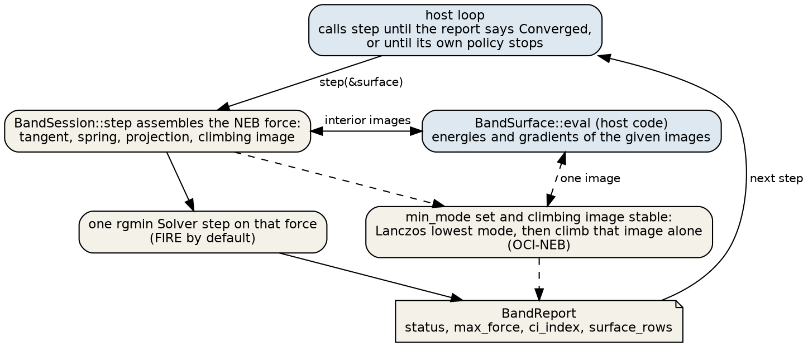
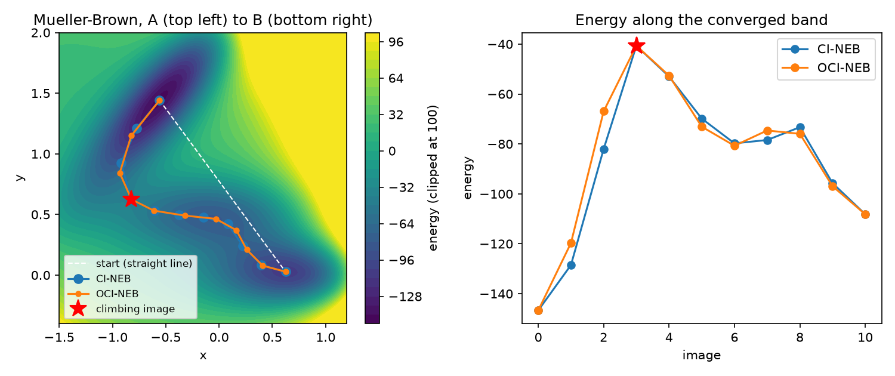
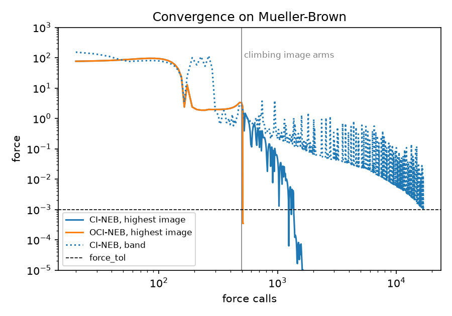

This tutorial finds the saddle between minima A and B of the Mueller-Brown surface, a two-dimensional model with three minima, with a nudged elastic band (NEB). It runs the search twice from the same start: once as a climbing-image NEB (CI-NEB), and once with this crate's default, which also refines the climbing image along the lowest curvature mode. That refinement is the off-path climbing image NEB (OCI-NEB) of Goswami, Gunde, and Jonsson, Front. Chem. 14 (2026), https://doi.org/10.3389/fchem.2026.1807063. The climbing image itself is Henkelman, Uberuaga, and Jonsson, J. Chem. Phys. 113, 9901 (2000). At the end you have the converged path, the saddle, and the force calls each method spent.


# What you need

A checkout of this repository and Rust 1.88 or newer. The figures also need [uv](https://docs.astral.sh/uv/).


# Run it

```console
$ cargo run --release --example muller_brown_band -- target/muller_brown
```

    ci-neb   Converged after 1712 steps, 16889 force calls, max force 9.8e-4, climbing image 3 at (-0.822002, 0.624313), energy -40.664844
    oci-neb  Converged after 50 steps, 513 force calls, max force 3.0e-4, climbing image 3 at (-0.822001, 0.624313), energy -40.664844

Both runs stop on the same saddle. The rest of this page goes through the program, `examples/muller_brown_band.rs`, and then the two figures.


# The surface

The host owns the potential. A `BandSurface` receives a block of images, one per row, and fills their energies and gradients. The atom moves in the plane z = 0, so the z gradient is zero. The counter is there only to count force calls.

```rust
/// One atom in the plane z = 0. Each image evaluated is one force call.
#[derive(Default)]
struct MullerBrown {
    force_calls: AtomicUsize,
}

impl BandSurface for MullerBrown {
    fn eval(
        &self,
        positions: ArrayView2<f64>,
        energies: &mut Array1<f64>,
        gradients: &mut Array2<f64>,
    ) -> Result<(), SaddleError> {
        self.force_calls
            .fetch_add(positions.nrows(), Ordering::Relaxed);
        for (i, row) in positions.outer_iter().enumerate() {
            let (energy, gx, gy) = muller_brown(row[0], row[1]);
            energies[i] = energy;
            gradients[(i, 0)] = gx;
            gradients[(i, 1)] = gy;
            gradients[(i, 2)] = 0.0;
        }
        Ok(())
    }
}
```


# The start and the two configurations

`linear_path` puts 11 images on the straight line from A to B. The endpoints never move. `max_move` caps each image's step at 0.05. The two configurations differ in one field: `min_mode: None` turns the refinement off and leaves plain CI-NEB.

```rust
    let minimum_a = array![-0.558223634633, 1.44172584195, 0.0];
    let minimum_b = array![0.623499404931, 0.028037758529, 0.0];
    let initial = linear_path(minimum_a.view(), minimum_b.view(), 11, None)?;
    write_band(&out.join("initial_band.csv"), initial.view())?;

    let oci_neb = BandConfig::default().with_max_move(0.05);
    let ci_neb = oci_neb.clone().with_min_mode(None);
    run("ci-neb", ci_neb, &initial, out)?;
    run("oci-neb", oci_neb, &initial, out)?;
    Ok(())
}
```


# The host loop

The session never runs to completion by itself. Each `step` assembles the NEB force and takes one solver step on it, and the host decides whether to call it again. `BandReport::surface_rows` counts the images the surface evaluated during the step; the example checks it against its own counter after every step.

```rust
let surface = MullerBrown::default();
let mut session = BandSession::new(config, initial.clone())?;
let mut trace = File::create(out.join(format!("{name}_trace.csv")))?;
writeln!(
    trace,
    "iteration,force_calls,max_force,climbing_image,top_gradient"
)?;
let mut force_calls = 0;
let report = loop {
    let report = session.step(&surface)?;
    force_calls += report.surface_rows;
    assert_eq!(force_calls, surface.force_calls.load(Ordering::Relaxed));
    let ci = report.ci_index.map_or(-1, |i| i as i64);
    let top = top_gradient(session.positions());
    writeln!(
        trace,
        "{},{force_calls},{:e},{ci},{top:e}",
        report.iteration, report.max_force
    )?;
    if report.status == BandStatus::Converged || report.iteration >= 5000 {
        break report;
    }
};
```




# The path



The climbing image is image 3 in both runs, at (-0.82200, 0.62431) with energy -40.664844. The Hessian there has eigenvalues -750.9 and 490.2, one negative, so the point is a first-order saddle. The band passes the intermediate minimum near image 6 and then crosses a lower barrier near images 7 and 8 on its way to B. One climbing image climbs only the highest barrier.


# Force calls



The first step evaluates 20 images and every later step 9, the interior images. The two runs take identical steps until step 52; the climbing image arms at step 51, after 470 force calls. From there OCI-NEB estimates the lowest mode at the climbing image and climbs that image alone. Its gradient is under `force_tol` (0.001) after 483 force calls, and the run stops.

The CI-NEB climbing image is under 0.001 for good from step 147, after 1334 force calls. The run continues to 16418 calls because its stopping test is different: CI-NEB stops when the projected force on every image is under `force_tol`, and OCI-NEB stops when the climbing image's own gradient is. After step 52 the OCI-NEB surface calls carry the climbing image alone, so the other images stay where that band step left them. That is why the two energy profiles differ away from the climbing image. Use CI-NEB when the whole path matters, and the default when the saddle is what you need.


# Make the figures

```console
$ uv run --no-project --with matplotlib --with numpy \
    python docs/source/figures/band-tutorial/plot.py target/muller_brown
$ (cd docs/source/figures/band-tutorial && dot -Tpng -Gdpi=150 host_loop.dot -o host_loop.png)
```

`plot.py` prints the climbing image, its Hessian eigenvalues, and the force-call counts quoted above.


# Next
