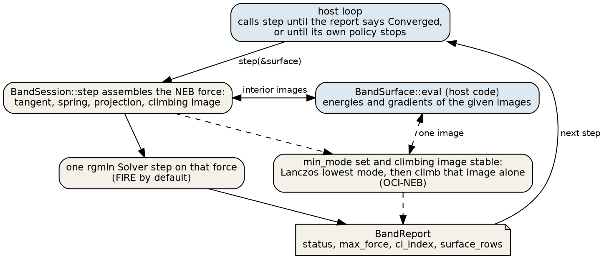
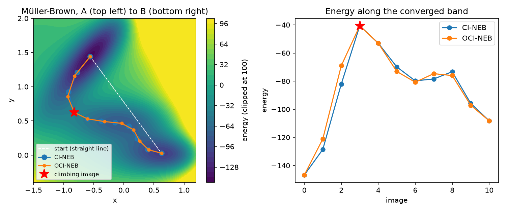
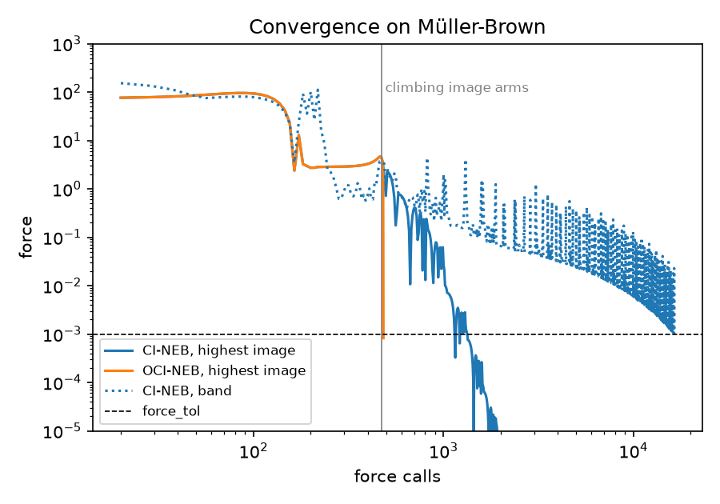

#+TITLE: Find a saddle with a nudged elastic band
#+OPTIONS: toc:nil num:nil author:nil ^:{}

This tutorial finds the saddle between minima A and B of the Mueller-Brown surface, a two-dimensional model with three minima, with a nudged elastic band (NEB). It runs the search twice from the same start: once as a climbing-image NEB (CI-NEB), and once with this crate's default, which also refines the climbing image along the lowest curvature mode. That refinement is the off-path climbing image NEB (OCI-NEB) of Goswami, Gunde, and Jonsson, Front. Chem. 14 (2026), doi:10.3389/fchem.2026.1807063. The climbing image itself is Henkelman, Uberuaga, and Jonsson, J. Chem. Phys. 113, 9901 (2000). At the end you have the converged path, the saddle, and the force calls each method spent.

#+begin_export rst
:cite:`goswamiEnhancedClimbingImage2026,henkelmanClimbingImageNudged2000`
#+end_export

* What you need
A checkout of this repository and Rust 1.88 or newer. The figures also need [[https://docs.astral.sh/uv/][uv]].

* Run it
#+begin_src console
$ cargo run --release --example muller_brown_band -- target/muller_brown
#+end_src

#+begin_example
ci-neb   Converged after 1823 steps, 16418 force calls, max force 1.0e-3, climbing image 3 at (-0.822002, 0.624313), energy -40.664844
oci-neb  Converged after 56 steps, 483 force calls, max force 6.8e-4, climbing image 3 at (-0.822000, 0.624314), energy -40.664844
#+end_example

Both runs stop on the same saddle. The rest of this page goes through the program, =examples/muller_brown_band.rs=, and then the two figures.

* The surface
The host owns the potential. A =BandSurface= receives a block of images, one per row, and fills their energies and gradients. The atom moves in the plane z = 0, so the z gradient is zero. The counter is there only to count force calls.

#+INCLUDE: "../../../examples/muller_brown_band.rs" src rust :lines "43-68"

* The start and the two configurations
=linear_path= puts 11 images on the straight line from A to B. The endpoints never move. =max_move= caps each image's step at 0.05. The two configurations differ in one field: =min_mode: None= turns the refinement off and leaves plain CI-NEB.

#+INCLUDE: "../../../examples/muller_brown_band.rs" src rust :lines "140-155"

* The host loop
The session never runs to completion by itself. Each =step= assembles the NEB force and takes one solver step on it, and the host decides whether to call it again. =BandReport::surface_rows= counts the images the surface evaluated during the step; the example checks it against its own counter after every step.

#+INCLUDE: "../../../examples/muller_brown_band.rs" src rust :lines "96-119"

#+ATTR_RST: :alt Flow of one BandSession step between the host loop, the session and the host surface
#+CAPTION: One call to step. Dashed arrows run only when min_mode is set and the climbing image has kept its index.

* The path
#+ATTR_RST: :alt Converged CI-NEB and OCI-NEB bands on Mueller-Brown contours, and their energy profiles
#+CAPTION: Left: converged bands on the Mueller-Brown contours, from the straight-line start. Right: energy along each band. The star is the climbing image.

The climbing image is image 3 in both runs, at (-0.82200, 0.62431) with energy -40.664844. The Hessian there has eigenvalues -750.9 and 490.2, one negative, so the point is a first-order saddle. The band passes the intermediate minimum near image 6 and then crosses a lower barrier near images 7 and 8 on its way to B. One climbing image climbs only the highest barrier.

* Force calls
#+ATTR_RST: :alt Force at the highest image against force calls for CI-NEB and OCI-NEB on a log scale
#+CAPTION: Gradient norm at the highest image against force calls, and the CI-NEB band's own max_force. The vertical line is where the climbing image arms.

The first step evaluates 20 images and every later step 9, the interior images. The two runs take identical steps until step 52; the climbing image arms at step 51, after 470 force calls. From there OCI-NEB estimates the lowest mode at the climbing image and climbs that image alone. Its gradient is under =force_tol= (0.001) after 483 force calls, and the run stops.

The CI-NEB climbing image is under 0.001 for good from step 147, after 1334 force calls. The run continues to 16418 calls because its stopping test is different: CI-NEB stops when the projected force on every image is under =force_tol=, and OCI-NEB stops when the climbing image's own gradient is. After step 52 the OCI-NEB surface calls carry the climbing image alone, so the other images stay where that band step left them. That is why the two energy profiles differ away from the climbing image. Use CI-NEB when the whole path matters, and the default when the saddle is what you need.

* Make the figures
#+begin_src console
$ uv run --no-project --with matplotlib --with numpy \
    python docs/source/figures/band-tutorial/plot.py target/muller_brown
$ (cd docs/source/figures/band-tutorial && dot -Tpng -Gdpi=150 host_loop.dot -o host_loop.png)
#+end_src

=plot.py= prints the climbing image, its Hessian eigenvalues, and the force-call counts quoted above.

* Next
#+begin_export rst
:doc:`../howto/band` covers tangents, springs, projections, and steppers. ``OcinebSession`` is the same refinement with the published hand-off controls. :doc:`../howto/autoneb` grows the band instead of fixing its size.
#+end_export
